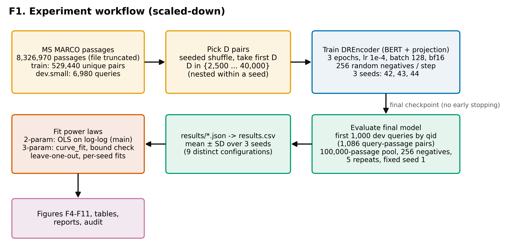
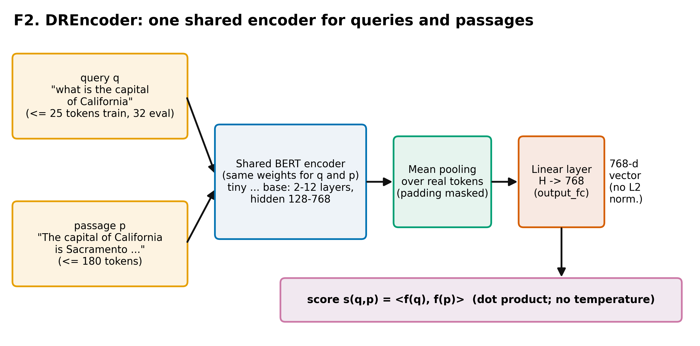
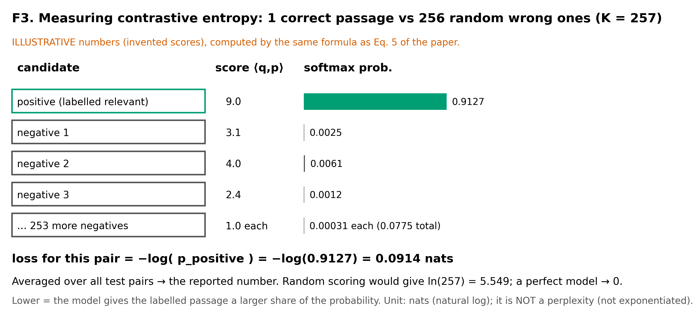
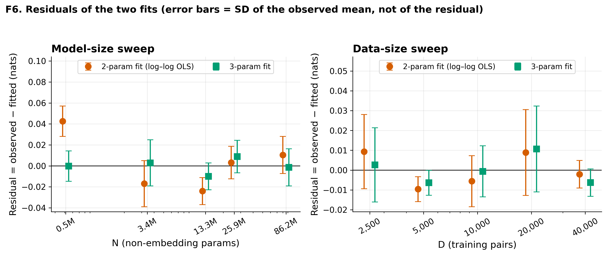
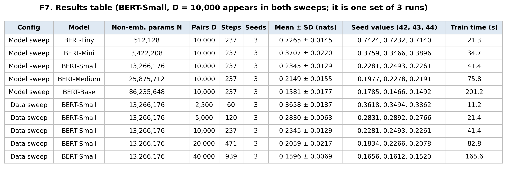
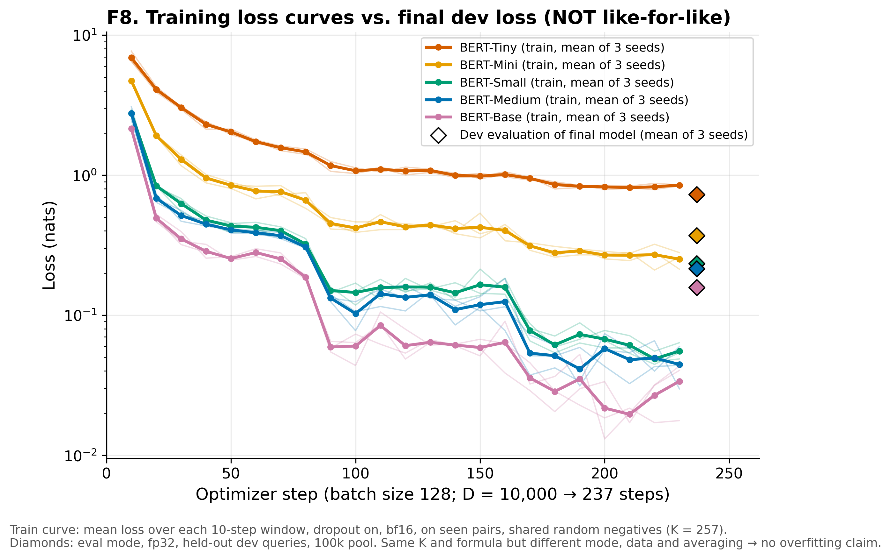
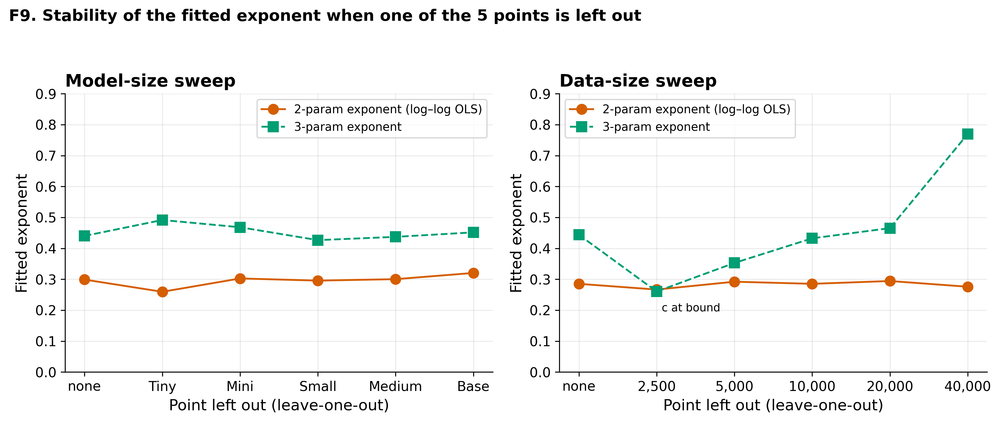
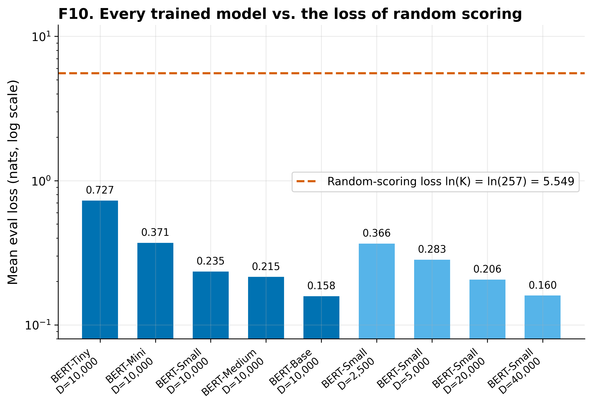
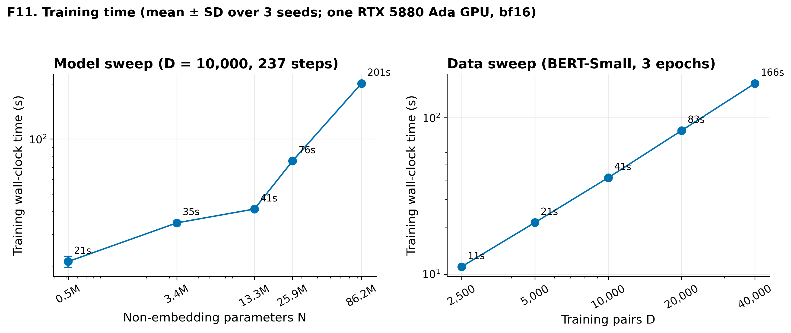

# Figures and tables guide (detailed)

*Start with README.md; this file is the detailed reference. It is written for someone who does not know information retrieval (IR) and does not know the project. All numbers are generated by script from the CSV/JSON files in `data/`.*

## 1. TL;DR

1. The paper (Fang et al., SIGIR '24, "Scaling Laws For Dense Retrieval") claims that the test loss of dense retrieval models falls as a power law of model size and of training-data size.
2. We trained 5 BERT sizes (D = 10,000 pairs) and BERT-Small with 5 data sizes (2,500 to 40,000 pairs), 3 seeds each, 27 runs on one GPU in about 58.2 minutes.
3. Loss falls with both model size (0.7265 → 0.1581 nats) and data size (0.3658 → 0.1596 nats); a 2-parameter power law fits both (R² of the log fit 0.986 and 0.989).
4. This is **not** a reproduction: our runs are 60–939 steps long (paper: 10,000), and exponents cannot be compared with the paper's.
5. The metric is a negative log-likelihood in nats (chance level ln(257) = 5.549), **not** a perplexity; the old axis label "Contrastive Perplexity" [OLD-LABEL] was wrong.

### What this package is and is not

It **is** a small, honest illustration of the two basic trends, with error bars from 3 seeds, an independent recomputation of every number, and an audit against the paper and the authors' code (`AUDIT_COMPLIANCE_MATRIX.md`).
It is **not** a replication of the paper: much shorter training, far less data, a smaller evaluation set, one dataset, and no test of annotation quality or budget allocation. Audit verdicts: A PASS WITH CAVEATS; B PASS WITH CAVEATS; C PASS WITH CAVEATS: definitions match; training length does not; D PASS WITH CAVEATS.

## 2. File map

| File / folder | What it is | When to use it |
|---|---|---|
| `README.md` | this guide | first |
| `REPORT_EN.md`, `REPORT_EN.pdf` | full English report (figures embedded) | source text for your report; the PDF for quick reading |
| `REPORT_VI.md`, `REPORT_VI.pdf` | same report in Vietnamese, same numbers | for the Vietnamese-speaking team member |
| `AUDIT_COMPLIANCE_MATRIX.md/.csv` | 42 requirements checked against paper, code and brief | to know what you may claim; see the verdicts at the bottom |
| `figures/` | F1–F11, PNG (300 dpi) and SVG | put in your report/slides |
| `tables/` | T1–T8 as CSV and Markdown | paste into your report |
| `data/` | `results.csv`, `results_summary.csv`, `results/*.json` (one per run), `figure_data/*.csv`, `run.log`, `status.json` | raw numbers behind every figure |
| `audit/` | JSON/CSV outputs of the checks (data, model, config, recomputation) | evidence for the audit |
| `scripts/` | code that draws figures, audits, builds the reports and checks the numbers | reproduction |
| `CHANGES_AUDIT.md` | what was added in this package | provenance |
| `CHECKSUMS.txt` | SHA-256 of every file | integrity |

## 3. Ten-minute reading order

1. Section 1 above (1 min). 2. The audit box at the top of `REPORT_EN.md` (1 min). 3. REPORT_EN Sec. 2 "Background" (3 min). 4. Figures F3, F4, F5 below with their "What you MAY claim" lines (3 min). 5. Section 6 of this file, the safe/unsafe claims (2 min).

## 4. Glossary

| Term | Meaning |
|---|---|
| Dense retrieval | Search where a neural network maps query and passage to vectors and the closest vectors win |
| Embedding | The vector (here 768 numbers) a model produces for a text |
| Contrastive loss / NLL | −log of the softmax probability the model gives the correct passage among K candidates; lower is better; unit nats |
| Negatives | Wrong passages added to the candidates; here 256 random passages from the corpus |
| Scaling law | Smooth relation between loss and model/data size, usually a power law |
| Power law | L = a·X^(−α); a straight line on log–log axes with slope −α |
| Non-embedding parameters | Model parameters excluding the word/position embedding tables; the paper's measure of model size |
| Seed | Integer that fixes random numbers (initialisation, data order, negatives) |
| R² | Share of the variance of the data explained by the fit (1 = perfect) |
| Standard deviation (SD) | Spread across the 3 seeds, computed with n − 1 |
| bf16 | 16-bit number format used during training to save time and memory |

## 5. Figures and tables, one by one

### F1. Experiment workflow



- **What it shows:** How the experiment runs, from data selection to fitted curves.
- **How to read it:** Boxes are stages; arrows show the order. Colours group data (orange), model (blue), evaluation (green), fitting (red), outputs (purple).
- **Key numbers:** 8,326,970 passages; 529,440 usable training pairs; 6,980 dev queries of which 1,000 are evaluated; 27 runs; 3 seeds.
- **What you MAY claim:** Describe our pipeline step by step.
- **What you must NOT claim:** Do not present it as the paper's pipeline.
- **Suggested caption:** Workflow of the scaled-down experiment: seeded subsets of MS MARCO training pairs, BERT dense retrievers, evaluation on a fixed set, and power-law fitting.
- **Source data file:** `data/figure_data/F1_workflow.csv`

### F2. DREncoder architecture



- **What it shows:** Query and passage go through the same BERT, are averaged into one vector and compared by dot product.
- **How to read it:** Left to right: text, shared encoder, mean pooling over real tokens, a linear layer to 768 numbers, then the dot product (bottom).
- **Key numbers:** Output dimension 768; query max 25 tokens (train) / 32 (eval); passage max 180 tokens; no normalisation, no temperature.
- **What you MAY claim:** Say the encoder is shared, uses mean pooling and a projection layer (paper Sec. 3.2, Eq. 2; code `modeling.py`).
- **What you must NOT claim:** Do not say vectors are normalised or that a temperature is used.
- **Suggested caption:** The DREncoder: one shared BERT, mean pooling, a linear projection to 768 dimensions and an inner-product score.
- **Source data file:** `data/figure_data/F2_architecture.csv`

### F3. How the contrastive loss is measured



- **What it shows:** How the loss is computed for one test pair: 1 correct passage against 256 random wrong ones.
- **How to read it:** Each row is a candidate with its score; the bar is its softmax probability; the loss is −log of the correct passage's probability.
- **Key numbers:** K = 257 candidates; random scoring gives ln(K) = 5.549; the invented example gives p = 0.9127 and loss 0.0914 nats.
- **What you MAY claim:** Use it to explain the metric; say the numbers in the picture are invented.
- **What you must NOT claim:** Do not read the example scores as real model outputs; do not call the metric a perplexity.
- **Suggested caption:** Illustration of contrastive entropy: the negative log of the probability that a softmax over one positive and 256 negatives assigns to the positive.
- **Source data file:** `data/figure_data/F3_contrastive_loss.csv`

### F4. Model-size scaling


- **What it shows:** Loss falls steadily as the encoder gets bigger (fixed 10,000 training pairs).
- **How to read it:** x: non-embedding parameters (log). y: loss in nats (log); lower is better. Blue dot = mean of 3 seeds, bar = ±1 SD; grey markers = single seeds; solid red-orange line = 2-parameter fit; dashed green = 3-parameter fit; equations and R² in the legend.
- **Key numbers:** Means: Tiny 0.7265, Mini 0.3707, Small 0.2345, Medium 0.2149, Base 0.1581. 2-param: exponent 0.299, R²(log) 0.9858. 3-param: exponent 0.440, c = 0.093, R² 0.9991. Leave-one-out 2-param exponent 0.259–0.320.
- **What you MAY claim:** Loss decreases as model size increases in our setting; a 2-parameter power law describes the five means well; the direction agrees with the paper (Fig. 3) within this reduced scope.
- **What you must NOT claim:** Do not say the paper was reproduced; do not compare α with the paper's 0.53; do not interpret the 3-parameter constant as an irreducible loss; do not extrapolate.
- **Suggested caption:** Contrastive entropy (nats) of BERT dense retrievers versus non-embedding parameters at 10,000 training pairs (mean ± SD of 3 seeds, log–log axes).
- **Source data file:** `data/figure_data/F4_model_scaling.csv`

### F5. Data-size scaling


- **What it shows:** Loss falls as BERT-Small sees more training pairs (and more steps).
- **How to read it:** Same encoding as F4; x is the number of training pairs D; the label under each point gives the number of optimizer steps (3 epochs).
- **Key numbers:** Means: D=2,500 0.3658; 5,000 0.2830; 10,000 0.2345; 20,000 0.2059; 40,000 0.1596. 2-param exponent 0.285, R²(log) 0.9887. 3-param exponent 0.444 but leave-one-out 0.260–0.770.
- **What you MAY claim:** Loss decreases as D (together with steps) increases; a 2-parameter power law describes the means.
- **What you must NOT claim:** Do not say the data alone caused the improvement (steps grow with D: 60 to 939); do not quote the 3-parameter exponent as a result; do not compare with the paper's β = 1.05.
- **Suggested caption:** Contrastive entropy of BERT-Small versus number of training pairs (3 epochs each; mean ± SD of 3 seeds, log–log axes).
- **Source data file:** `data/figure_data/F5_data_scaling.csv`

### F6. Residuals of the fits



- **What it shows:** How far each mean lies from each fitted curve.
- **How to read it:** y = observed − fitted (nats), zero line in black; orange circles: 2-parameter fit; green squares: 3-parameter fit; bars are the SD of the observed mean.
- **Key numbers:** Max |residual|: model sweep 0.0426 (2-param) and 0.0100 (3-param); data sweep 0.0096 and 0.0107.
- **What you MAY claim:** Say both fits follow the data to within a few hundredths of a nat and that the 3-parameter fit has smaller residuals because it has more freedom.
- **What you must NOT claim:** Do not use smaller residuals as proof that the 3-parameter model is the true law.
- **Suggested caption:** Residuals of the 2- and 3-parameter power-law fits for the model-size and data-size sweeps.
- **Source data file:** `data/figure_data/F6_residuals.csv`

### F7. Results table (image)



- **What it shows:** All 9 configurations in one table.
- **How to read it:** Each row is a configuration; mean ± SD over 3 seeds; the three single-seed values; steps; training time.
- **Key numbers:** Best mean 0.1581 (BERT-Base, 10,000 pairs); worst mean 0.7265 (BERT-Tiny); SD is 2.0%–11.2% of the mean.
- **What you MAY claim:** Quote any number in the table.
- **What you must NOT claim:** Do not count BERT-Small with 10,000 pairs twice.
- **Suggested caption:** Mean ± SD of the contrastive entropy (nats) over 3 seeds for every configuration.
- **Source data file:** `data/figure_data/F7_results_table.csv`

### F8. Training curves



- **What it shows:** Training loss per 10-step window against the final dev loss.
- **How to read it:** Lines: training loss (bold = mean of 3 seeds, faint = single seeds). Diamonds: dev loss of the final model.
- **Key numbers:** Last-window train loss vs dev loss: Tiny 0.8494 vs 0.7265; Small 0.0555 vs 0.2345; Base 0.0338 vs 0.1581.
- **What you MAY claim:** Say training loss was still falling at the end of the short runs.
- **What you must NOT claim:** Do NOT say the models over-fit: the two losses differ in mode (dropout), precision, data and averaging, so they are not comparable.
- **Suggested caption:** Training loss (10-step means) of the five models; diamonds mark the final held-out evaluation loss, which is computed differently.
- **Source data file:** `data/figure_data/F8_train_loss_curves.csv`

### F9. Leave-one-out stability



- **What it shows:** How much the fitted exponent moves when one of the five points is removed.
- **How to read it:** x: the point left out; y: exponent. Orange circles: 2-parameter; green squares: 3-parameter.
- **Key numbers:** 2-param exponent range: model 0.259–0.320, data 0.267–0.294. 3-param: model 0.426–0.492, data 0.260–0.770.
- **What you MAY claim:** Say the 2-parameter exponents are stable and the 3-parameter data exponent is not.
- **What you must NOT claim:** Do not report a single 3-parameter exponent without this range.
- **Suggested caption:** Leave-one-out stability of the fitted exponents.
- **Source data file:** `data/figure_data/F9_loo_stability.csv`

### F10. Comparison with random scoring



- **What it shows:** Every trained model is far better than random scoring.
- **How to read it:** Bars: mean loss (log scale); dashed line: ln(257), the loss of random scoring.
- **Key numbers:** ln(257) = 5.5491; best/chance = 0.028; worst/chance = 0.131.
- **What you MAY claim:** Say all models learned to separate the positive from random passages.
- **What you must NOT claim:** Do not say a loss of 0.16 means 84% accuracy or any ranking metric.
- **Suggested caption:** Mean contrastive entropy of each configuration compared with the loss ln(257) of random scoring.
- **Source data file:** `data/figure_data/F10_chance_level.csv`

### F11. Training time



- **What it shows:** Training time grows with model size and with data.
- **How to read it:** Wall-clock training seconds (log–log), mean ± SD over 3 seeds, left by model, right by D.
- **Key numbers:** Model sweep: Tiny 21.3 s … Base 201.2 s; data sweep: D=2,500 11.2 s … D=40,000 165.6 s.
- **What you MAY claim:** Report these times with the hardware ({gpu}).
- **What you must NOT claim:** Do not extrapolate costs to other GPUs.
- **Suggested caption:** Training time of each configuration on one RTX 5880 Ada GPU (mean ± SD over 3 seeds).
- **Source data file:** `data/figure_data/F11_train_time_model.csv`

### T1

- **What it shows:** All configurations with mean ± SD, seeds, steps and times.
- **Key numbers:** Best mean 0.1581, worst 0.7265.
- **Files:** `tables/T1_results_mean_sd.md` (paste-ready), `tables/T1_results_mean_sd.csv`
- **What you MAY claim:** any number in it, with the caveats in Section 6.
- **What you must NOT claim:** anything the checklist in Section 6 lists as unsafe.

### T2

- **What it shows:** 2- and 3-parameter fits for both sweeps.
- **Key numbers:** Model: α 0.299, R²(log) 0.9858; data: α 0.285, R²(log) 0.9887.
- **Files:** `tables/T2_fits.md` (paste-ready), `tables/T2_fits.csv`
- **What you MAY claim:** any number in it, with the caveats in Section 6.
- **What you must NOT claim:** anything the checklist in Section 6 lists as unsafe.

### T5

- **What it shows:** Which neighbouring settings are separated by more than the seed spread.
- **Key numbers:** 2 of 8 neighbouring pairs overlap: Small vs Medium and D = 10,000 vs 20,000.
- **Files:** `tables/T5_adjacent_pairs.md` (paste-ready), `tables/T5_adjacent_pairs.csv`
- **What you MAY claim:** any number in it, with the caveats in Section 6.
- **What you must NOT claim:** anything the checklist in Section 6 lists as unsafe.

### T6

- **What it shows:** How the parameter counts are built up.
- **Key numbers:** Base: 86,235,648 including the projection layer and the unused pooler (82.2 M in units of 2^20).
- **Files:** `tables/T6_parameter_counts.md` (paste-ready), `tables/T6_parameter_counts.csv`
- **What you MAY claim:** any number in it, with the caveats in Section 6.
- **What you must NOT claim:** anything the checklist in Section 6 lists as unsafe.

### T7

- **What it shows:** Paper's fitted values next to ours, with warnings.
- **Key numbers:** Paper α = 0.53 (Table 1), β = 1.05 (Table 2); ours (3-param) 0.440 and 0.444; NOT comparable.
- **Files:** `tables/T7_paper_vs_ours_exponents.md` (paste-ready), `tables/T7_paper_vs_ours_exponents.csv`
- **What you MAY claim:** any number in it, with the caveats in Section 6.
- **What you must NOT claim:** anything the checklist in Section 6 lists as unsafe.

## 6. Checklist: safe and unsafe statements

**Safe**

* "In a heavily scaled-down setting (237 steps, up to 58.2 GPU-minutes in total), the loss moves in the same direction as in the paper."
* "Mean contrastive entropy falls from 0.7265 to 0.1581 nats from BERT-Tiny to BERT-Base at 10,000 pairs (3 seeds)."
* "A 2-parameter power law fits both sweeps (R² of the log fit 0.986 and 0.989); its exponents are stable when one point is left out."
* "The metric is a negative log-likelihood in nats over 1 positive and 256 random negatives; random scoring gives 5.549."
* "There is no query overlap between training and evaluation (checked by code)."

**Unsafe (do not write)**

* "We reproduced the paper" or "we confirmed the scaling law of the paper".
* Comparing our exponents with the paper's α = 0.53 or β = 1.05 as if they measured the same thing.
* "Contrastive perplexity" [OLD-LABEL] for our numbers, or any statement that values below 1 are perplexities.
* "The models over-fit" (train and eval losses are not comparable, matrix D6).
* "BERT-Small and BERT-Medium differ significantly" or "D = 10,000 and 20,000 differ significantly" (±SD intervals overlap).
* Using the 3-parameter constant c as an irreducible loss, or the 3-parameter data exponent 0.444 as a result.
* Anything about annotation quality, budget allocation or T2Ranking (not tested).
* "The data size alone improved the loss" (steps grow with D).

## 7. Paper versus our experiment

| Aspect | Paper (section / figure) | Our experiment |
|---|---|---|
| Task / data | MS MARCO passage (8.8M passages, 0.5M train queries) and T2Ranking (Sec. 3.3) | MS MARCO only; passage file truncated to 8,326,970 passages (94.18%) |
| Models | 24 Google BERT checkpoints 0.5M–82M non-emb. params; ERNIE for T2Ranking (Sec. 3.2) | 5 BERT checkpoints: Tiny, Mini, Small, Medium, Base (same family as the paper's red stars, Fig. 3) |
| N definition | non-embedding parameters (Sec. 3.2, footnote 2) | non-embedding incl. projection layer and unused BERT pooler (= the paper's Fig. 6 legend sizes when divided by 2^20) |
| D definition | number of annotated query–passage pairs (Sec. 3.1, 4.2) | number of (qid, pid) training pairs |
| Architecture | shared encoder + projection to 768; CLS or mean pooling (Sec. 3.2, Eq. 2) | shared BERT + mean pooling + Linear(H→768); no normalisation |
| Training loss | softmax cross-entropy, random + in-batch negatives (Sec. 3.4, Eq. 3) | same: 1 positive + 256 random negatives shared by the batch; mean CE; no temperature |
| Optimisation length | fixed 10,000 steps (Sec. 3.4) | 3 epochs → 60–939 steps (depends on D); 237 steps for the model sweep |
| lr / batch / optimiser | not stated in the paper (UNVERIFIED) | lr 1e-4, batch 128, AdamW, linear decay, warmup 10 steps, bf16 |
| Metric | contrastive entropy = −log softmax of the positive among 1+256 candidates (Sec. 3.5, Eq. 5) | same quantity (mean NLL, nats), K = 257 |
| Evaluation set | dev queries (~7,000, Sec. 3.3); 100,000-passage sub-corpus used for the metric study (Sec. 3.5) | first 1,000 dev.small queries by qid (1,086 pairs); 100,000-passage pool; 5 repeats; fixed eval seed 1 |
| Checkpoint reported | best test loss during training, no early stopping (Sec. 4.1) | final checkpoint after epoch 3 |
| Model sweep | full training set, many models (Sec. 4.1, Fig. 3) | D = 10,000 pairs, 5 models |
| Data sweep | BERT-Base, up to all ~500K annotations (Sec. 4.2, Fig. 4) | BERT-Small, D = 2,500 … 40,000 |
| Fit form | L = (A/N)^α + δ (Eq. 6); L = (B/D)^β + δ (Eq. 7); joint Eq. 8 | 3-param a·X^-α + c (same family; a = A^α) and a 2-param a·X^-α (extra, main) |
| Seeds | not stated (UNVERIFIED) | 3 training seeds 42/43/44; evaluation seed fixed |
| Annotation quality, budget allocation | Sec. 4.3 (ICT, docT5query, ChatGLM3), Sec. 5 | not reproduced |

## 8. Limitations and threats to validity

Short schedules (60–939 steps vs 10,000 in the paper, matrix C7); final instead of best checkpoint (C11); five points and three seeds per sweep; a 3-parameter fit with two degrees of freedom and an unstable data exponent (Sec. 5.3 of the report); evaluation on the 1,000 smallest-qid dev queries (mildly unrepresentative, D7) with a fixed evaluation seed (D3); a truncated corpus (94.18% of MS MARCO, D8); learning rate chosen from two values with an almost untrained model (D5); train and eval losses not comparable (D6); one dataset, one model family, in-domain only.

## 9. Reproduction information

* **Hardware (as run):** NVIDIA RTX 5880 Ada Generation (49,140 MiB; driver 580.178.04, nvidia-smi on 2026-10-29); Intel Core Ultra 9 285K (24 logical CPUs), 93 GiB RAM; peak allocated GPU memory 4645.6 MiB (`data/status.json`).
* **Software:** Python 3.11.7, PyTorch 2.11.0+cu128, Transformers 4.52.4, NumPy 1.26.4, SciPy 1.16.3, pandas 2.3.3, Matplotlib 3.10.6.
* **Seeds:** training 42, 43, 44; evaluation 1 (fixed).
* **Settings:** lr 1e-4, 3 epochs, batch 128, AdamW, linear decay, warm-up 10 steps, bf16, 256 negatives, evaluation with 1,000 queries, pool 100,000, 5 repeats.
* **Run time:** 58.2 min of summed per-run wall-clock (training 1966 s, evaluation 1368 s).
* **Commands:** see Section 8 of the report. **Original repository commit:** `81453c3b67486641ad282d58f819392a08561e77` (github.com/jingtaozhan/DRScale).
* Regenerating the figures F8 needs the checkpoint folders (`trainer_state.json`); everything else only needs `data/`.

## 10. How to cite

Verified metadata (Crossref API, arXiv API and the paper's own ACM reference line, p. 1):

```
@inproceedings{fang2024scaling,
  author    = {Fang, Yan and Zhan, Jingtao and Ai, Qingyao and Mao, Jiaxin and Su, Weihang and Chen, Jia and Liu, Yiqun},
  title     = {Scaling Laws For Dense Retrieval},
  booktitle = {Proceedings of the 47th International ACM SIGIR Conference on Research and Development in Information Retrieval (SIGIR '24)},
  year      = {2024},
  pages     = {1339--1349},
  address   = {Washington, DC, USA},
  publisher = {ACM},
  doi       = {10.1145/3626772.3657743}
}
arXiv:2403.18684 [cs.IR], v2, 15 July 2024.
```

Repository: J. Zhan et al., DRScale, https://github.com/jingtaozhan/DRScale, commit `81453c3b67486641ad282d58f819392a08561e77` (the GitHub owner name is taken from the repository's git remote; the authorship of the repository itself is UNVERIFIED beyond that). Ranking of the venue: CORE 2023 lists SIGIR as A* (portal.core.edu.au); a CCF 2026 list mirror lists it as A. **Ask your lecturer which ranking the course uses.**

## 11. Mapping to your course report, and likely questions

| Report part | Use |
|---|---|
| Introduction / background | REPORT_EN Sec. 2, F2, F3 |
| The paper | REPORT_EN Sec. 3 (all statements have section/figure references) |
| Our demo / experiment | F1, T8 (Section 7 above), F4, F5, T1 |
| Analysis | F6, F9, T2, T5 |
| Limitations | Section 8 above, matrix C7, D6 |
| Q&A | the questions below |

**Likely questions and short answers**

1. *What does the metric measure?* The negative log of the probability the model assigns to the correct passage among 1 + 256 candidates; lower is better; unit nats.
2. *Why not perplexity?* Our code never exponentiates; values 0.1581–0.7265 are below 1, which a perplexity cannot be. exp of the mean is 1.171–2.068 if you want it.
3. *Did you reproduce the paper?* No. We see the same direction (loss falls with N and D); our runs are 60–939 steps long against 10,000 and use less data, so exponents differ and are not comparable.
4. *Which fit do you trust?* The 2-parameter one: exponents 0.299 and 0.285 barely move when a point is dropped. The 3-parameter data exponent moves between 0.260 and 0.770.
5. *Are neighbouring models really different?* Mostly yes, but Small and Medium (0.2345 ± 0.0129 vs 0.2149 ± 0.0155) and D = 10,000 vs 20,000 are not separated by the seed spread.
6. *Did the models overfit?* We cannot say: training loss (0.0555 for Small in the last window) and dev loss (0.2345) are computed differently.
7. *Is there leakage?* No query ID is shared between training and the evaluation set (0 overlaps), and identical query texts number 0.
8. *Why 3 epochs and not 10,000 steps?* Budget: the whole study took about 58.2 GPU-minutes. Consequence: models are not converged (F8).
9. *Why do your parameter counts include a pooler and a projection layer?* That is the repository's definition; in units of 2^20 it reproduces the sizes in the paper's Fig. 6 legend (0.5, 3.3, 12.7, 24.7, 82.2 M).
10. *What would you do next?* Train for 10,000 steps, use BERT-Base for the data sweep with larger D, report the best checkpoint, add more seeds and test whether a law fitted on small models predicts a held-out larger one.

## 12. Tóm tắt 10 dòng bằng tiếng Việt cho người trong nhóm

1. Gói này là thí nghiệm minh họa thu nhỏ bài SIGIR '24 "Scaling Laws For Dense Retrieval", KHÔNG phải tái hiện bài báo.
2. Chúng ta chạy 27 lần (5 cỡ BERT với D = 10,000; BERT-Small với D từ 2,500 đến 40,000; 3 seed) trong khoảng 58.2 phút GPU.
3. Loss giảm khi mô hình lớn hơn (0.7265 xuống 0.1581 nat) và khi dữ liệu nhiều hơn (0.3658 xuống 0.1596 nat): cùng chiều với bài báo trong phạm vi thu nhỏ.
4. Thước đo là NLL (nat), không phải perplexity; nhãn cũ "Contrastive Perplexity" [OLD-LABEL] sai và đã sửa; đoán ngẫu nhiên là 5.549.
5. Khớp lũy thừa 2 tham số tốt và ổn định (số mũ 0.299 và 0.285); khớp 3 tham số cho chuỗi dữ liệu không ổn định, đừng dùng làm kết quả chính.
6. Số mũ của chúng ta không so sánh được với bài báo (0.53 và 1.05) vì chỉ huấn luyện 60–939 bước thay vì 10,000, dữ liệu ít hơn.
7. Hai cặp điểm liền kề (Small–Medium, D = 10,000–20,000) không tách biệt khi so với SD giữa các seed.
8. Không được nói "overfitting": loss huấn luyện và loss đánh giá không tính cùng cách (ma trận D6).
9. Kiểm toán: 24 MATCH, 12 DEVIATION-JUSTIFIED, 3 DEVIATION-IMPACTFUL (B8, C7, C9), 3 UNVERIFIED (A4, C18, D6).
10. Việc cần làm: xác nhận với giảng viên bảng xếp hạng (CORE A* hay CCF), chuẩn bị slide và demo, và dùng đúng các câu "an toàn" ở Mục 6.
