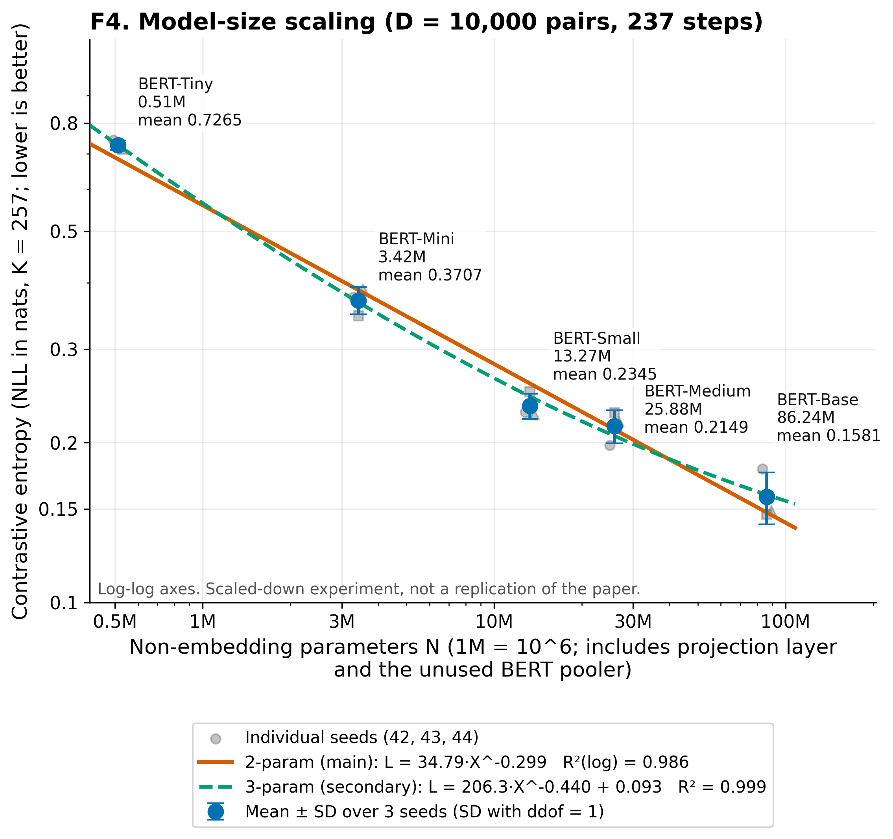
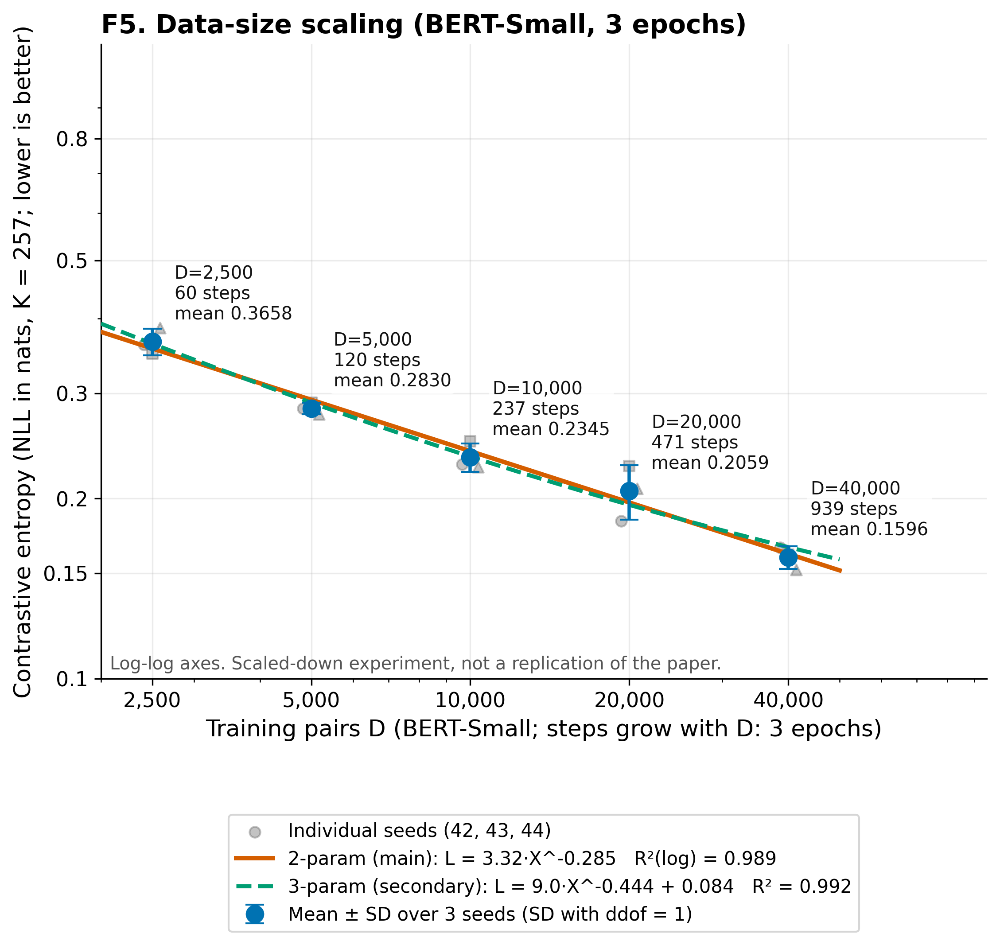

# How to write your report with this package

*A plain-English guide. You do not need to know information retrieval (IR). Every number below is generated by script from the result files in `data/`.*

**Your task:** write a course report that explains one IR paper and our small demo experiment (a 2-person group, a 10–15 minute talk, a live demo, Q&A).
**The paper:** Fang et al., *Scaling Laws For Dense Retrieval*, SIGIR 2024 (arXiv 2403.18684).

> **Most important rule:** our experiment is a **small illustration**, not a reproduction of the paper. Write "in a heavily scaled-down setting, the loss moves in the same direction as in the paper". Never write "we reproduced the paper".

## 1. The paper in 60 seconds

* **Dense retrieval** = search with a neural network. The network turns the question and every text passage into a list of numbers (a *vector*). The passage whose vector is closest to the question's vector is the best match.
* **Question of the paper:** if we make the model bigger, or give it more training examples, does it improve in a *predictable* way? A predictable curve is called a **scaling law** (a straight line on a log–log plot).
* **Answer of the paper:** yes. Loss falls as a power law of model size and of the number of training pairs (paper Sec. 4.1–4.2, Fig. 3–4, Tables 1–2).
* **How the paper measures quality:** the *contrastive entropy*. Give the model 1 correct passage and 256 random wrong ones. The loss is large if the model gives the correct one a small probability, and zero if it is certain (Sec. 3.5, Eq. 5). Lower is better.
* **Why it matters:** with such curves you can predict big experiments from small ones and decide how to split a budget between labelling data and training (Sec. 5). The paper also tests labels made by machines (Sec. 4.3); we did not.

## 2. What we did and found

We trained 5 BERT models of different sizes (512,128 to 86,235,648 parameters) on 10,000 training pairs, and one model (BERT-Small) on 2,500 up to 40,000 pairs. Each setting was repeated with 3 random seeds (27 runs, about 58.2 GPU-minutes in total, one NVIDIA RTX 5880 Ada GPU).

| Finding | Number |
|---|---|
| Bigger model → lower loss | 0.7265 (Tiny) → 0.1581 (Base) nats |
| More data → lower loss | 0.3658 (2,500 pairs) → 0.1596 (40,000 pairs) nats |
| A straight line on log–log axes fits well (2-parameter power law) | R² = 0.986 (model), 0.989 (data); slopes 0.299 and 0.285 |
| The slopes are stable | leave one point out: 0.259–0.320 and 0.267–0.294 |
| Random guessing would give | ln(257) = 5.549 nats; our worst model gets 0.7265 |

**Limits you must mention:** our runs take only 60–939 training steps while the paper uses 10,000 (paper Sec. 3.4); we use up to 40,000 pairs while the paper goes to about 500,000; we use one dataset (MS MARCO); we did not test annotation quality or budget planning. Because of this, **our slopes cannot be compared with the paper's** (0.53 and 1.05, Tables 1–2).




## 3. Report outline with ready-made text

| Section of your report | What to write | Use |
|---|---|---|
| 1. Introduction | What dense retrieval is; why scaling laws matter | Section 1 above; `REPORT_EN.md` Sec. 2; figure `figures/F2_architecture.png` |
| 2. The paper | Question, method, main results, with paper section numbers | `REPORT_EN.md` Sec. 3 |
| 3. How the metric works | One correct passage vs 256 wrong ones; loss formula | `figures/F3_contrastive_loss.png` |
| 4. Our experiment | Data, models, training, evaluation, hardware | `REPORT_EN.md` Sec. 4; table `tables/T8_paper_vs_ours_setup.md` |
| 5. Results | Two curves, one table, careful wording | F4, F5, `tables/T1_results_mean_sd.md` |
| 6. Discussion and limits | Same direction as the paper; why not comparable | `REPORT_EN.md` Sec. 7; `tables/T7_paper_vs_ours_exponents.md` |
| 7. Demo | Search with our trained models, good and bad cases | `demo/demo.py` (Section 7 below) |
| 8. Conclusion | 3 sentences | Section 4 below |

**Copy-paste text (edit freely).**

* *Method of the paper.* "Fang et al. (2024) train dense retrievers of different sizes on MS MARCO and measure the contrastive entropy, the negative log-probability that a softmax over one relevant and 256 random passages gives the relevant one (Sec. 3.5, Eq. 5). They find that this loss follows a power law in the number of non-embedding parameters (Sec. 4.1, Table 1) and in the number of annotated pairs (Sec. 4.2, Table 2)."
* *Our experiment.* "We trained five BERT dense retrievers (512,128–86,235,648 parameters) for 237 steps on 10,000 training pairs, and BERT-Small on 2,500–40,000 pairs, with three seeds each. We evaluated on 1,000 development queries with 256 random negatives."
* *Results.* "The mean loss falls from 0.7265 to 0.1581 nats as the model grows, and from 0.3658 to 0.1596 nats as the data grows. A two-parameter power law fits both sweeps (R² = 0.986 and 0.989 on log scale). The direction agrees with the paper within this reduced scope."
* *Limitations.* "Our runs are much shorter than the paper's (60–939 steps against 10,000), use less data and a smaller evaluation set, so the fitted exponents are not comparable with the paper's. Two neighbouring points (BERT-Small and BERT-Medium; 10,000 and 20,000 pairs) are not separated by the spread between seeds."
* *Conclusion.* "Within a small experiment, larger models and more data give lower contrastive entropy, consistent in direction with Fang et al. (2024). We cannot confirm the paper's exponents, and we did not test annotation quality or budget allocation."

## 4. Do and do not

| You MAY write | You must NOT write |
|---|---|
| "Loss decreases as model size and data size increase in our setting" | "We reproduced the paper" / "we confirmed the scaling law" |
| "A 2-parameter power law fits (R² = 0.986, 0.989)" | Our slope compared with the paper's 0.53 or 1.05 as if they were the same measurement |
| "The metric is a negative log-likelihood in nats; random guessing gives 5.549" | "Perplexity" for our numbers (values below 1 cannot be perplexities) |
| "Two neighbouring points overlap within the seed spread" | "BERT-Small is significantly better than BERT-Medium" (it is not separated) |
| "Training and test losses are computed differently, so we do not compare them" | "The models over-fit" (training and test loss are computed differently) |
| "More data (and more training steps) lower the loss" | "Data size alone lowers the loss" (steps grow with data in our runs) |
| Anything the paper says, with its section/figure number | Anything about annotation quality, budget or T2Ranking as *our* result |

## 5. Mini glossary

| Word | Meaning |
|---|---|
| Query / passage | The question / a short text that may answer it |
| Vector (embedding) | The list of numbers (768 here) a model gives to a text |
| Positive / negative | The labelled correct passage / a wrong passage |
| Loss, NLL, nat | How surprised the model is by the correct answer; −log(probability); nat = unit with natural log |
| Parameters (N), training pairs (D) | Model size and number of (query, correct passage) pairs |
| Power law | L = a·X^(−slope): straight line on log–log axes |
| R² | How well a line fits (1 = perfect) |
| Seed, SD | Random-number setting; spread (standard deviation) across the 3 seeds |

## 6. Questions you may get (short answers)

1. **What does the loss measure?** How little probability the model gives the correct passage among 1 + 256 candidates; lower is better.
2. **Did you reproduce the paper?** No; same direction only. Our runs are much shorter, use less data and a smaller test set.
3. **Which fit do you trust?** The 2-parameter line: its slope hardly changes when a point is removed (0.259–0.320). The 3-parameter data slope moves between 0.260 and 0.770.
4. **Are neighbouring models really different?** Mostly yes; but Small vs Medium (0.2345 ± 0.0129 vs 0.2149 ± 0.0155) overlap.
5. **Did the models over-fit?** We cannot say; train and test losses are computed differently.
6. **Is there data leakage?** No: no query appears in both training and test (0 overlaps, checked by code).
7. **Why so few training steps?** Compute budget: the whole study took about 58.2 GPU-minutes. Models are not fully trained.
8. **What next?** 10,000 steps, bigger data for BERT-Base, more seeds, test whether small-model curves predict a larger model.

## 7. The live demo (code in `demo/`)

`demo/demo.py` retrieves passages with our trained checkpoints (needs a GPU machine with the checkpoints; they are not stored in this repository). Examples (run inside the `demo/` folder):

```
python3 demo.py prepare                         # one-off: encode a 21,086-passage pool with every model
python3 demo.py cases                           # table: every model's loss and retrieval hit rates
python3 demo.py compare "What is the capital of California?" --models tiny small base
python3 demo.py compare --qid 54235 --models tiny small base    # a development query with its labelled answer marked
```
The pool is tiny compared with the real corpus (8.3M passages), so demo ranks are easier than real search. Your teammate has the demo plan with good and bad cases.

## 8. Where is everything

| Path | What |
|---|---|
| `REPORT_EN.md` / `.pdf` | Full English report to copy from (every number generated by script) |
| `FIGURES_AND_TABLES_GUIDE.md` | For every figure and table: what it shows, how to read it, what you may and must not claim, suggested caption |
| `figures/` | F1–F11 (PNG 300 dpi + SVG) |
| `tables/` | Tables T1–T8 (Markdown to paste, CSV) |
| `AUDIT_COMPLIANCE_MATRIX.md` | Check of our work against the paper, the authors' code and the task (read the verdicts at the bottom) |
| `data/` | Raw results: `results.csv`, `results_summary.csv`, one JSON per run |
| `scripts/` | Code that builds figures, checks and reports |
| `REPORT_VI.md` | The same report in Vietnamese (for your teammate) |

## 9. How to cite

```
@inproceedings{fang2024scaling,
  author    = {Fang, Yan and Zhan, Jingtao and Ai, Qingyao and Mao, Jiaxin and Su, Weihang and Chen, Jia and Liu, Yiqun},
  title     = {Scaling Laws For Dense Retrieval},
  booktitle = {Proceedings of the 47th International ACM SIGIR Conference on Research and Development in Information Retrieval (SIGIR '24)},
  year      = {2024}, pages = {1339--1349}, address = {Washington, DC, USA}, publisher = {ACM}, doi = {10.1145/3626772.3657743}
}
```
Venue ranking: CORE 2023 lists SIGIR as A* (verified at portal.core.edu.au); a CCF 2026 list mirror lists it as A. Ask your lecturer which ranking the course uses. Code of the paper: https://github.com/jingtaozhan/DRScale (commit `81453c3b67486641ad282d58f819392a08561e77`).
